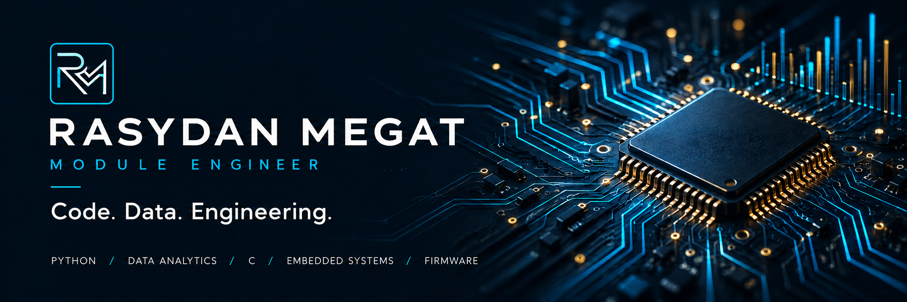
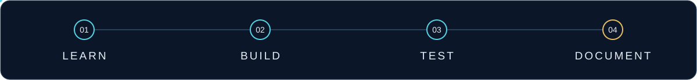
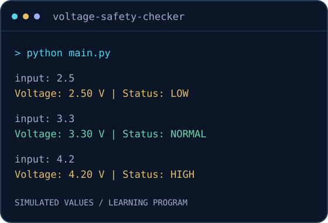

  

  <strong>Preparing for opportunities in Embedded Systems, Firmware &amp; Test Engineering</strong> 
  LEARNING FOCUS &nbsp; / &nbsp; Python · Data Analytics · C · Embedded Systems · Firmware

  
  
  

  <a href="https://www.linkedin.com/in/rasydan-bin-megat-ridzuan-350b2426a/">LinkedIn ↗</a> &nbsp;·&nbsp;
  <a href="https://github.com/RasydanMegat?tab=repositories">All repositories ↗</a> &nbsp;·&nbsp;
  <a href="mailto:rasydan.mgtridzuan@gmail.com">Email ↗</a>

I am a **Module Engineer** expanding my knowledge in **Python, data analytics, C, embedded systems, and firmware** as I prepare to pursue embedded, firmware, and test engineering roles. This portfolio shares my projects, technical development, and learning journey.

## 01 / Python Engineering Portfolio

<table>
<tr>
<td width="54%" valign="top">
  <h3>Building a programming foundation.</h3>
  
Engineering-focused Python programs covering input validation, reusable functions, text processing, data structures, and result summaries.

  
Each completed program includes source code, usage instructions, and documented manual checks.

  
<code>Python</code> <code>Problem solving</code> <code>Git</code>

  
<a href="https://github.com/RasydanMegat/python-engineering-portfolio"><strong>Explore the Python portfolio →</strong></a>

</td>
<td width="46%" align="center" valign="middle">
  
  SIMULATED INPUT · DOCUMENTED PROGRAM OUTPUT
</td>
</tr>
</table>

| Completed programs | Fundamentals | Current focus |
|:---:|:---:|:---:|
| **16** | **Complete** | **Data structures** |

**Selected work:** [Voltage Safety Checker](https://github.com/RasydanMegat/python-engineering-portfolio/tree/main/01-python-fundamentals/04-functions/voltage-safety-checker) · [Engineering Conversion Toolkit](https://github.com/RasydanMegat/python-engineering-portfolio/tree/main/01-python-fundamentals/04-functions/engineering-conversion-toolkit) · [Sensor Reading Analyzer](https://github.com/RasydanMegat/python-engineering-portfolio/tree/main/01-python-fundamentals/03-loops/sensor-reading-analyzer)

[Follow my Python learning roadmap →](https://github.com/RasydanMegat/python-engineering-portfolio/blob/main/ROADMAP.md)

 

## 02 / Semiconductor Quality Analytics

### Turning process data into a clearer picture.

A **four-page Power BI report** exploring semiconductor test outcomes using the UCI SECOM dataset. Move from the quality overview to measurement comparisons, data completeness, and drillthrough to individual samples.

<code>Power BI</code> <code>Power Query</code> <code>DAX</code> <code>Data modelling</code>

| Samples | Measurements | Report pages |
|:---:|:---:|:---:|
| **1,567** | **590** | **4** |

**[Explore the project →](https://github.com/RasydanMegat/semiconductor-quality-analytics)** &nbsp;·&nbsp; [Model & calculations](https://github.com/RasydanMegat/semiconductor-quality-analytics/blob/main/docs/technical-notes.md) &nbsp;·&nbsp; [Open in Power BI Desktop](https://github.com/RasydanMegat/semiconductor-quality-analytics#open-locally)

Static preview of the actual report. Interactive exploration is available in Power BI Desktop.

 

## 03 / Embedded Systems & Firmware

### Developing the next layer of my skills.

📚 **Learning in progress · Coursera**

I am currently taking courses on Coursera and developing my knowledge of **C, embedded systems, and firmware**. This repository is the starting point for my personal notes, original code, and future hands-on projects.

<code>C</code> <code>Embedded fundamentals</code> <code>Firmware</code>

**[Follow my embedded & firmware learning →](https://github.com/RasydanMegat/embedded-firmware-learning)**

---

## 🧭 Learning direction

| Area | Where I am now | Where I am heading |
|:---|:---|:---|
| **Python** | Fundamentals complete; data structures in progress | Files and error handling → OOP → larger projects → engineering simulations |
| **Data analytics** | Published a semiconductor analysis project in Power BI | Continue developing data preparation, modelling, and analytical reporting skills |
| **Embedded & firmware** | Coursera learning in progress | Build foundations in C and embedded systems, then document hands-on work |

## How I learn

**Understand the concept. Build something. Check the result. Document the learning.**

I write an initial solution, test it, and use AI-assisted explanations and review to understand and correct mistakes. My repositories document both completed work and the skills I am still developing.

## 🤝 Let's connect

Interested in my work or learning journey? Connect with me on LinkedIn or explore the repositories above.

**[LinkedIn ↗](https://www.linkedin.com/in/rasydan-bin-megat-ridzuan-350b2426a/)** &nbsp;·&nbsp; **[Email ↗](mailto:rasydan.mgtridzuan@gmail.com)** &nbsp;·&nbsp; **[GitHub repositories ↗](https://github.com/RasydanMegat?tab=repositories)**

  RASYDAN MEGAT &nbsp; / &nbsp; Code. Data. Engineering.

