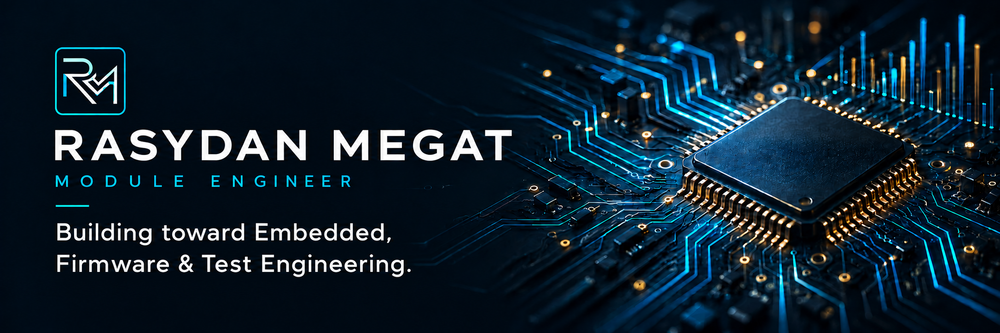
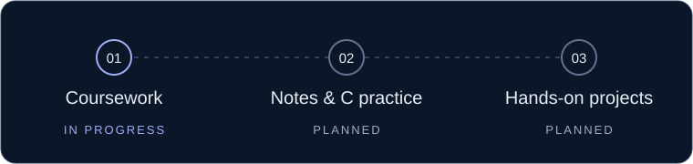

  

I'm **Rasydan**, a Module Engineer developing skills in **Python, C, embedded systems, and firmware**. This portfolio brings together my projects, practical work, and ongoing learning.

  <a href="#01--python-engineering-portfolio">Python portfolio</a> &nbsp;·&nbsp;
  <a href="#02--power-bi--semiconductor-quality--yield">Power BI project</a> &nbsp;·&nbsp;
  <a href="#03--embedded--firmware-learning">Embedded &amp; firmware</a> &nbsp;·&nbsp;
  <a href="https://www.linkedin.com/in/rasydan-bin-megat-ridzuan-350b2426a/">LinkedIn ↗</a>

## 01 / Python Engineering Portfolio

**In progress** · 16 completed programs

Engineering-focused Python programs covering validation, reusable functions, text processing, and data structures. Each includes runnable code, usage instructions, and documented manual checks.

  

   
  Voltage Safety Checker · Simulated input · Illustrated output

**[Explore Python →](https://github.com/RasydanMegat/python-engineering-portfolio)** &nbsp;·&nbsp; [Learning roadmap](https://github.com/RasydanMegat/python-engineering-portfolio/blob/main/ROADMAP.md)

Selected programs: [Voltage Safety Checker](https://github.com/RasydanMegat/python-engineering-portfolio/tree/main/01-python-fundamentals/04-functions/voltage-safety-checker) · [Engineering Conversion Toolkit](https://github.com/RasydanMegat/python-engineering-portfolio/tree/main/01-python-fundamentals/04-functions/engineering-conversion-toolkit) · [Sensor Reading Analyzer](https://github.com/RasydanMegat/python-engineering-portfolio/tree/main/01-python-fundamentals/03-loops/sensor-reading-analyzer)

## 02 / Power BI — Semiconductor Quality & Yield

**Published project** · 4 report pages · 1,567 samples · 590 measurements

A Power BI report exploring semiconductor test outcomes from the UCI SECOM dataset. It connects a quality overview with measurement comparisons, data completeness, and individual sample investigation.

  

   
  Actual report screenshot · Click to enlarge

**[Explore Power BI →](https://github.com/RasydanMegat/semiconductor-quality-analytics)** &nbsp;·&nbsp; [Model & calculations](https://github.com/RasydanMegat/semiconductor-quality-analytics/blob/main/docs/technical-notes.md) &nbsp;·&nbsp; [Open in Power BI Desktop — instructions](https://github.com/RasydanMegat/semiconductor-quality-analytics#open-locally)

## 03 / Embedded & Firmware Learning

**Learning in progress** · Coursera coursework

I'm studying C, embedded systems, and firmware through Coursera coursework. I'll add personal notes, original code, and practical projects as I progress.

  

   
  Learning plan · Notes and projects will be added as they are ready

**[Explore embedded & firmware learning →](https://github.com/RasydanMegat/embedded-firmware-learning)**

## 🧭 Current focus & next steps

- **Current focus:** Python data structures and Coursera learning in embedded systems and firmware.
- **Next steps:** Files and error handling, then object-oriented programming; document C and embedded learning as I progress.
- **Longer term:** Larger Python projects, engineering simulations, and hands-on embedded work.

I learn by writing an initial solution, testing its behaviour, and using AI-assisted explanations and review to understand and correct mistakes.

## 🤝 Connect

**[LinkedIn ↗](https://www.linkedin.com/in/rasydan-bin-megat-ridzuan-350b2426a/)** &nbsp;·&nbsp; **[Email ↗](mailto:rasydan.mgtridzuan@gmail.com)** &nbsp;·&nbsp; **[All repositories ↗](https://github.com/RasydanMegat?tab=repositories)**
